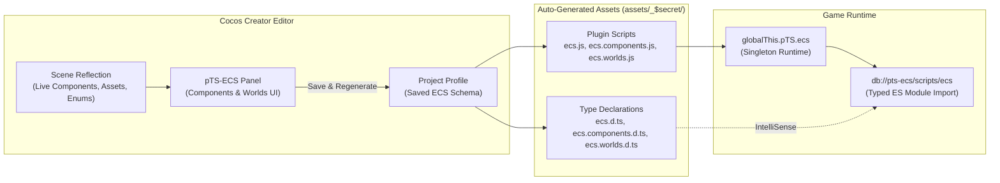

# pTS-ECS

A lightweight, high-performance **Entity Component System (ECS)** extension for **Cocos Creator 3.8.8+**, featuring a visual schema editor, automatic TypeScript `.d.ts` code generation, zero-allocation bitmask queries, spatial-hash 2D collision resolution, and strongly typed per-world event channels.

---

## Features

- **Visual Schema Editor (`pTS-ECS` Panel)**: Define ECS **Components** and **Worlds** visually inside the Cocos Creator editor — dockable side-by-side with your Scene or Inspector panels.
- **Full TypeScript IntelliSense**: Saving your schema automatically generates runtime plugin scripts (`ecs.components.js`, `ecs.worlds.js`) and ambient TypeScript declarations (`ecs.components.d.ts`, `ecs.worlds.d.ts`) so `ecs.get_world("game")` knows every component bit, property type, and event name at compile time.
- **Cascading Type Selector & Live `Enum` Discovery**: Pick property types from 6 categorized flyout menus (`Primitive`, `Cocos Node`, `Components`, `Assets`, `ECS Component`, `Enum`). Registered Cocos & project `Enum`s (e.g., `Enum(KeyCode)`, custom `Enum(EAnimState)`) are discovered directly from live memory — with a member dropdown for default values.
- **Typed World Events**: Choose per-world event typing between `primitive` (`string | symbol`) or `manual` (strict string literal union like `"on_hit" | "on_move"`).
- **Zero-Allocation Runtime**: Uses `Uint32Array` bitmasks, dense swap-remove entity pools, and a built-in spatial-hash 2D collision solver (`world.collide`).
- **Portable Extension**: Self-contained under `extensions/pts-ecs` — drop it into any Cocos Creator 3.8.8+ project (alongside `pts-core`).

---

## Requirements

- **Cocos Creator**: `>= 3.8.8`
- **Peer Extension**: `pts-core` (provides the global `pTS` namespace)

---

## Installation & Setup

1. Copy the `pts-ecs` folder into your project's `extensions/` directory:
   ```text
   <your-project>/extensions/pts-ecs
   ```
2. Build the extension (if `dist/` is not already compiled):
   ```bash
   cd extensions/pts-ecs
   npm install
   npm run build
   ```
3. Enable **pts-ecs** in Cocos Creator via **Extension → Extension Manager**.
4. Open the editor panel via **Extension → pTS-ECS → Open Panel** (or **Project → Project Settings → pTS ECS → Open ECS Panel**).

---

## Architecture Overview



---

## Using the `pTS-ECS` Panel

### 1. Components Tab

Define reusable data structures for your entities:

1. Click **+ Component** and give it a unique name (e.g., `XPos`, `XSpeed`, `XDash`).
2. Add properties to the component. Each property has:
   - **Name**: Field identifier (e.g., `x`, `y`, `key`, `target`).
   - **Type** *(Cascading Hover Menu)*: Hover over a category to open the searchable submenu:
     - `Primitive [N] ▸` — `float`, `int`, `string`, `boolean`, `object`, `Int32Array`, `Uint32Array`
     - `Cocos Node` — 1-click direct selection for `cc.Node`
     - `Components [N] ▸` — Built-in & custom `@ccclass` `cc.Component` subclasses
     - `Assets [N] ▸` — `SpriteFrame`, `SpriteAtlas`, `Prefab`, `AudioClip`, custom `Asset` subclasses, etc.
     - `ECS Component [N] ▸` — Embed another ECS component as a nested struct
     - `Enum [N] ▸` — Any `Enum(...)` registered in Cocos or your project scripts
   - **Collection**: Wrap the type as `Single`, `Array` (`T[]`), `Set` (`Set<T>`), or `Map` (`Map<any, T>`).
   - **Default**: Default value emitted in the component factory. When the type is an `Enum`, this automatically turns into a dropdown of that enum's registered members (e.g., `SPACE (32)`).

### 2. Worlds Tab

Configure isolated ECS worlds:

1. Click **+ World** and configure:
   - **Name**: Unique world identifier (e.g., `"game"`, `"ui"`).
   - **Capacity**: Initial pre-allocated entity pool capacity.
   - **Max Entities**: Upper entity limit for the world.
   - **Events**:
     - `Primitive`: Allows any `string | symbol` event channel.
     - `Manual`: Define an explicit list of event names (e.g., `on_hit`, `on_move`, `on_dash`). `world.event.push(...)` and `world.event.flush(...)` will strictly type-check against this union.
2. Check the **Components** that belong to this world. Each checked component gets a unique bit index inside `world.bits`.

### 3. Save & Regenerate

Click **Save & Regenerate** in the panel (or **Extension → pTS-ECS → Regenerate Plugins & Types**). This validates your schema, persists it to the project profile, and regenerates:
- `assets/_$secret/ecs.components.js` & `ecs.components.d.ts`
- `assets/_$secret/ecs.worlds.js` & `ecs.worlds.d.ts`

---

## Runtime Usage

### Importing `ecs`

You can import `ecs` via Cocos's `db://` module path (recommended for clean imports) or access the global `pTS.ecs` directly:

```ts
import { ecs } from "db://pts-ecs/scripts/ecs";
```

### Quick Start Example

```ts
import { _decorator, Component } from "cc";
import { ecs } from "db://pts-ecs/scripts/ecs";

const { ccclass } = _decorator;

@ccclass("GameSystem")
export class GameSystem extends Component {
    // Strongly typed world from the pTS-ECS panel ("game")
    private _world = ecs.get_world("game");

    start() {
        const { XPos, XSpeed, XCollision } = this._world.bits;

        // 1. Spawn an entity with component bits
        const id = this._world.entity.add(XPos, XSpeed, XCollision);

        // 2. Read / write component data
        const pos = this._world.component.get(id, XPos)!;
        pos.x = 100;
        pos.y = 200;

        // 3. Get-or-add with default value (3rd parameter)
        const speed = this._world.component.get(id, XSpeed, { value: 180 });
        speed.value = 220;
    }

    update(dt: number) {
        const { XPos, XSpeed, XCollision } = this._world.bits;

        // 4. Query all entities that have both XPos & XSpeed
        this._world.query([XPos, XSpeed], (id, pos, speed) => {
            pos.x += speed.value * dt;
        });

        // 5. Spatial-hash 2D circle collision
        this._world.collide(XPos, XCollision, {
            chunk_size: 64,
            iterations: 2,
            on_collide: (id_a, id_b) => {
                // 6. Push typed world event (if "on_hit" is defined in World Events)
                this._world.event.push("on_hit", id_a, id_b);
            },
        });

        // 7. Flush queued events
        this._world.event.flush("on_hit", (id_a, id_b) => {
            // Handle collision pair
        });
    }
}
```

### Creating a Dynamic World at Runtime

If you need a temporary or procedural world outside the panel schema:

```ts
const temp_world = ecs.create_world({
    name: "temp_fx",
    capacity: 256,
    max_entities: 1024,
    components: {
        XPos: () => ({ x: 0, y: 0 }),
        XLife: () => ({ ttl: 1.0 }),
    },
});

// Later, safely clean up
ecs.delete_world("temp_fx");
```

---

## API Reference

### Top-Level `ecs` Module

| Method | Description |
| :--- | :--- |
| `ecs.create_world(args)` | Creates and registers a new world with a unique `name`. Throws if the name is empty or already exists. |
| `ecs.get_world(name)` | Returns the bound world facade for `name` with full generated component & event types. |
| `ecs.delete_world(target)` | Destroys and unregisters a world by name or instance. Returns `true` if removed. |
| `ecs.match(flag, req)` | Low-level bitmask check: returns `true` if `flag` contains all bits in `req`. |

### Bound World (`IBoundWorld`)

| Member / Method | Description |
| :--- | :--- |
| `world.name` | Unique name of the world. |
| `world.bits` | Read-only map of component names to typed bit indices (`TBit<TComp>`). |
| `world.entity.add(...bits)` | Spawns a new entity and initializes all specified components. Returns the entity `id`. |
| `world.entity.remove(id)` | Destroys an entity and recycles its ID and component slots. |
| `world.entity.flag(id)` | Returns the entity's `Uint32Array` component bitmask. |
| `world.entity.has_all(id, mask)` | Checks if an entity matches all bits in `mask`. |
| `world.entity.has_any(id, mask)` | Checks if an entity matches any bit in `mask`. |
| `world.entity.count()` | Returns the active entity count. |
| `world.component.add(id, bit, prop?)` | Adds (or overwrites) a component on an entity, optionally initialized with `prop`. |
| `world.component.get(id, bit)` | Returns the component instance on `id`, or `undefined` if absent. |
| `world.component.get(id, bit, default_prop)` | Returns the existing component, or adds & returns a new component initialized with `default_prop`. |
| `world.component.has(id, bit)` | Returns `true` if `id` currently has the component. |
| `world.component.remove(id, bit)` | Removes the component from `id` and clears its bit. |
| `world.query([bitA, bitB, ...], cb)` | Iterates every entity matching all bits, passing `(id, compA, compB, ...)` with full type inference. |
| `world.event.push(channel, a, b?)` | Queues a numeric pair event `(a, b)` on `channel` (zero-allocation ring/array queue). |
| `world.event.flush(channel, handler)` | Drains all queued events on `channel`, invoking `handler(a, b)` for each. Returns count flushed. |
| `world.event.clear(channel?)` | Clears a specific event channel, or all channels if omitted. |
| `world.collide(pos_bit, col_bit, opts?)` | Runs spatial-hash 2D circle collision separation & callbacks (`chunk_size`, `iterations`, `target`, `on_collide`). |
| `world.mask(...bits)` | Builds a reusable `Uint32Array` bitmask for the given component bits. |
| `world.reset()` | Clears all entities, components, and queued events while keeping the world registered. |
| `world.destroy()` | Releases all internal buffers and unregisters the world. |

---

## How Live `Enum` Discovery Works

Cocos Creator's `Enum(obj)` does not maintain a global list — it only attaches a hidden `__enums__` property to `obj`. To populate the **Enum** category in the panel **without scanning `.ts` source files on disk**, `pts-ecs` runs a 4-tier in-memory reflection pass inside the Scene process:

1. **`cc.Enum` Hook**: Wraps `cc.Enum` in memory to capture newly registered enums on script reload.
2. **`cc.*` & Static Class Scan**: Detects engine enums mutated in place by `Enum(KeyCode)` or nested class enums like `cc.Sprite.Type`.
3. **`CCClass.Attr` Inspection**: Reads `$enumList` metadata from `@property({ type: Enum(...) })` decorators on registered classes.
4. **`Editor.Module.importProjectModule`**: Inspects already-loaded project script exports via Cocos's internal `cce.Script._executor` to pick up custom exported enums (e.g., `Enum(EAnimState)`).

---

## Headless AI / MCP Automation (Optional)

If your workspace also includes `pts-cc-mcp`, the MCP server automatically detects `extensions/pts-ecs` and registers the `ecs_manage` tool — allowing AI agents to inspect, create, update, or delete ECS components and worlds headlessly without manually clicking through the UI.

---

## Directory Structure

```text
extensions/pts-ecs/
├── assets/
│   ├── _$secret/               # Core plugin runtime (ecs.js/.d.ts) + auto-generated schema files
│   └── scripts/                # ES module facade (db://pts-ecs/scripts/ecs)
├── i18n/                       # Localization strings (en, zh)
├── source/
│   ├── codegen.ts              # Generates ecs.components.{js,d.ts} & ecs.worlds.{js,d.ts}
│   ├── main.ts                 # Extension lifecycle, profile I/O, IPC handlers
│   ├── panel.ts                # Dockable pTS-ECS editor panel & cascading type flyout
│   ├── scene.ts                # Scene-process live reflection (Components, Assets, 4-tier Enums)
│   ├── schema.ts               # Schema interfaces & built-in fallback catalogs
│   └── validator.ts            # Schema validation rules
├── bootstrap.js                # Extension entry point
└── package.json                # Cocos Creator v2 extension manifest
```

---

## Development

```bash
cd extensions/pts-ecs

# One-time build
npm run build

# Watch mode during development
npm run watch
```
